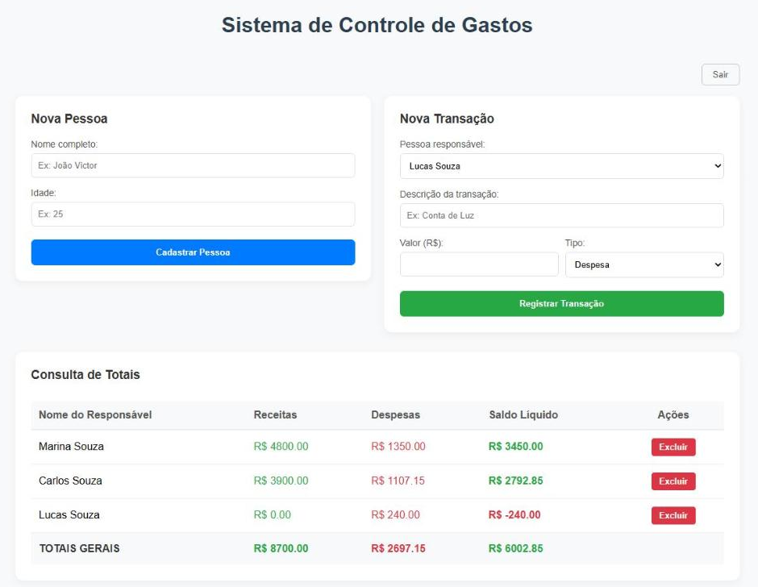
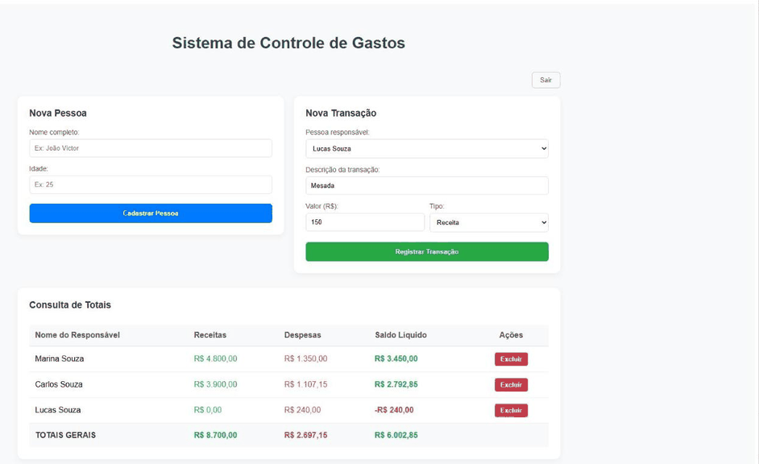

# CashFlow

Controle de gastos da casa. Cadastra as pessoas da família, registra receitas e despesas de cada uma e mostra o total por pessoa e o total geral.



## Tecnologias

- **API:** C# com .NET 10 (ASP.NET Core), Entity Framework Core e SQLite
- **Front-end:** React com TypeScript (Vite), Axios e React Toastify
- **Testes:** xUnit com `WebApplicationFactory` (a API sobe inteira, com um banco SQLite temporário)

## Decisões

1. **A regra de negócio fica no back-end.** Menor de 18 anos não pode registrar receita. A regra está no `TransacaoService`: a API responde `400 Bad Request` e o front-end só mostra o aviso. Assim a regra vale mesmo para quem chamar a API direto.

   

2. **Excluir uma pessoa apaga as transações dela.** Usei a exclusão em cascata do Entity Framework para não sobrar transação sem dono.
3. **O front-end é organizado por assunto.** As pastas `pessoas` e `transacoes` guardam tudo de cada parte, em vez de separar por tipo de arquivo.
4. **O banco é criado sozinho.** A API aplica as migrations ao iniciar, então basta rodar para testar.

## Segurança

Usei os riscos do OWASP API Security Top 10 como guia. Os controles principais têm teste de integração em `CashFlow.Api.Tests`.

- **Login com JWT.** `POST /api/auth/registrar` cria a conta e `POST /api/auth/login` devolve um token que vale 60 minutos. Toda rota exige token por padrão; só `/api/auth` é aberta. A API aceita só tokens HS256 com emissor, público, assinatura e validade corretos. Os testes tentam token expirado, assinado com outra chave, com payload alterado e com `alg: none`, e todos levam `401`.
- **Senha nunca é salva.** Guardo só o hash (PBKDF2, pelo `PasswordHasher` do ASP.NET Core). O login dá a mesma resposta para "e-mail não existe" e "senha errada", para ninguém descobrir quais e-mails têm conta.
- **Validação de entrada.** A API recebe DTOs, não as entidades do banco. Nome só com letras, idade de 0 a 130, valor maior que zero com até 2 casas, tipo só `Receita` ou `Despesa`. Campo desconhecido no JSON é recusado com `400`.
- **Limite de tentativas.** 5 tentativas de login ou cadastro por IP a cada minuto e 100 requisições por IP por minuto na API toda. Passou disso, a resposta é `429` com o header `Retry-After`.
- **Headers de segurança.** `Content-Security-Policy`, `X-Content-Type-Options`, `X-Frame-Options`, `Referrer-Policy`, `Permissions-Policy` e `Cache-Control: no-store` em todas as respostas, inclusive nas de erro. HSTS fora do ambiente de desenvolvimento e sem o header `Server`.
- **Erros e CORS.** Erro sai no formato ProblemDetails, sem stack trace. O CORS só libera as origens listadas em `Cors:Origens`.

**Falha que encontrei e corrigi:** o `POST /api/pessoas` recebia a entidade `Pessoa` inteira. Dava para cadastrar alguém de 15 anos já com uma lista de transações do tipo Receita no mesmo JSON, e a regra do menor de idade era ignorada (mass assignment). Agora a API só aceita `nome` e `idade`, e o teste `Mass_assignment_de_transacoes_na_pessoa_e_bloqueado` garante isso.

## Como rodar

Precisa do Node.js e do .NET 10 SDK.

API:

```bash
cd CashFlow.Api
dotnet run
```

Front-end, em outro terminal:

```bash
cd CashFlow.Web
npm install
npm run dev
```

Depois abra o endereço que aparecer no terminal (normalmente http://localhost:5173).

Testes, na raiz do projeto:

```bash
dotnet test
```

Os mesmos testes rodam no GitHub Actions a cada push (`.github/workflows/ci.yml`).

### Chave do JWT

A chave não fica no repositório. Em desenvolvimento, se nenhuma chave for configurada, a API gera uma nova a cada execução (é só entrar de novo depois de reiniciar). Para fixar uma chave na sua máquina:

```bash
cd CashFlow.Api
dotnet user-secrets init
dotnet user-secrets set "Jwt:Key" "uma-chave-aleatoria-com-pelo-menos-32-caracteres"
```

Em produção a API não inicia sem a variável de ambiente `Jwt__Key`.
